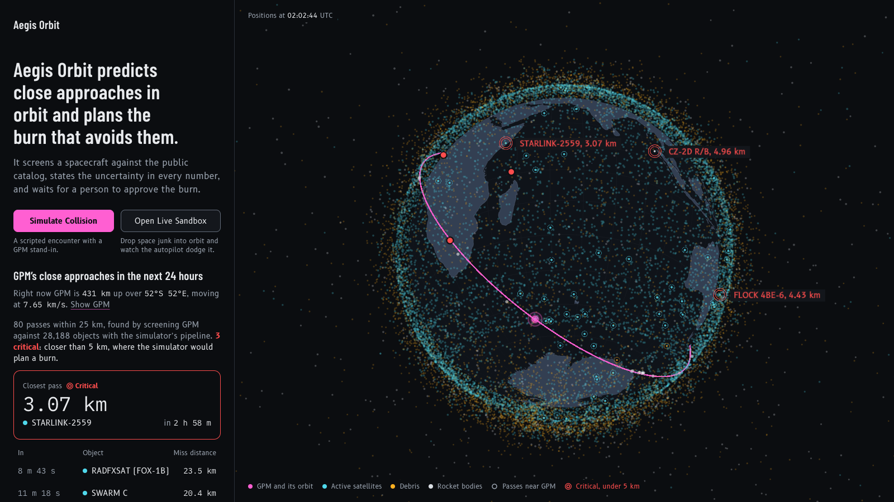
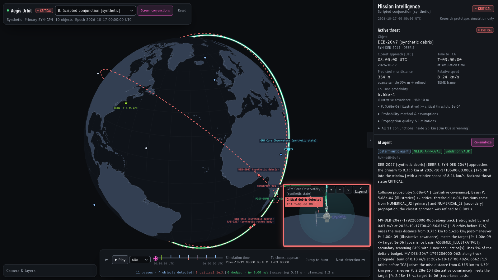

# Aegis Orbit — Autonomous Orbital Collision Avoidance Simulator

An interactive, AI-assisted collision-avoidance simulator for satellites: **predict, plan, avoid, explain**.
A Python physics engine propagates real and synthetic orbits, screens for close approaches, estimates
collision probability with explicit uncertainty labels, plans candidate avoidance burns and screens them
for secondary risks. A deterministic reasoning agent orchestrates those tools and explains its
recommendation; a human approves or rejects the *simulated* maneuver in a Waymo-style 3D visualisation of
the orbital environment.

> **Research and simulation prototype.** Positions are SGP4 estimates from public mean elements or
> synthetic states, not sensor telemetry. Nothing here is flight software and no spacecraft is commanded.





## What it does

1. Loads public orbital data (CelesTrak GP/TLE records, cached and committed as a fixture under `backend/data/`) and a deterministic synthetic scenario.
2. Propagates trajectories (SGP4 for catalog objects; two-body + J2 RK4 for synthetic states and post-burn arcs).
3. Screens the primary against the catalog for close approaches (coarse filter → batch propagation → local minima → bounded refinement → dedup → ranking).
4. Computes collision probability with the 2-D encounter-plane (Foster) method **only when covariance inputs exist**; otherwise reports `UNVERIFIED`.
5. Plans candidate maneuvers with a documented grid search and objective (delta-v cost vs. risk reduction).
6. Re-screens every candidate's post-burn trajectory against the catalog (secondary screening).
7. Runs a deterministic tool-calling agent that explains the threat, the assessment, the candidates, the secondary risks and the uncertainties — it follows a fixed workflow (screen → details → plan → secondary checks → report), every number comes from a backend tool result, every tool call is logged, and the final recommendation is validated against the tool outputs. The whole flow works offline.
8. Runs a **perception layer**: an XGBoost risk ranker trained on CelesTrak-derived screening labels scores every catalog object from its orbital elements in milliseconds; the physics screening verifies the flagged objects and assigns tiers (CRITICAL / SEMI_CRITICAL / ML_WATCH), served by `GET /api/perception`. The model only ranks; every displayed distance and time is computed. On the real ISS scenario the mission page plays it as a funnel over the full 18,598-object catalog and ends in an operator decision (see Scenario A).
9. Visualises the emergency on a CesiumJS globe: the spacecraft, drawn with its true-scale design model (NASA's glTF for the ISS and GPM, part-built for other designs), its planned path as a teal band half an orbit ahead, the threat object's path, the predicted TCA with its danger region and miss vector, and the candidate and approved maneuvers.
10. Requires explicit human approval before the simulated maneuver is applied. An approved burn becomes part of the spacecraft's trajectory (a piecewise path: the native model up to the burn, a two-body + J2 arc after it), so every later screening, plan and trajectory sees the committed path. Each committed burn leaves a translucent **ghost** of the spacecraft flying the course it did not take until the pass the burn avoided; the close-up follows a ghost on request, the clock slows down before its collision and a warning shows what would have happened (with the true miss distance).
11. Offers a live **sandbox** (Scenario C): the clock runs open-ended, you drop space junk onto the orbit (three kinds with different pass distances), and an **autopilot** screens it, plans a burn that meets both the probability and the 5 km distance target, secondary-checks it and flies it, with the spacecraft's thrusters firing on the model when the burn happens.

## Stack

| Layer | Technology |
|---|---|
| Frontend | React 19 + TypeScript, Vite 7, CesiumJS 1.146 (globe), Tailwind CSS 4, Recharts 3, Zustand |
| Backend | Python 3.12, FastAPI, Pydantic 2, NumPy, SciPy, `sgp4`, `xgboost` 3.4 (+ scikit-learn twin) |
| Data | CelesTrak GP data (committed fixture + optional live refresh), deterministic synthetic scenario |
| AI | XGBoost perception ranker (physics-verified); deterministic tool-calling agent with report validation |

## Quick start

Prerequisites: Node 22+, Python 3.12+. On this machine Python 3.12 was installed with
[`uv`](https://docs.astral.sh/uv/) (`uv python install 3.12`); a plain `python3.12 -m venv` works too.

### 1. Backend

```bash
cd backend
uv venv .venv --python 3.12            # or: python3.12 -m venv .venv
uv pip install --python .venv/bin/python -r requirements-dev.txt   # or: .venv/bin/pip install -r requirements-dev.txt
                                        # requirements.txt is the runtime set (what a deployment installs); -dev adds pytest
cp ../.env.example .env                 # optional: adjust network/CORS settings
scripts/enable_xgboost_macos.sh         # macOS without Homebrew only: lets the xgboost wheel find an OpenMP runtime
.venv/bin/uvicorn app.main:app --reload --port 8000
```

The PyPI `xgboost` wheel for macOS links against `libomp.dylib` but does not ship it. The script above adds a
loader-relative search path so it reuses the copy bundled with scikit-learn (no Homebrew needed); `brew install libomp`
works too. If xgboost still cannot import, the backend automatically uses the scikit-learn twin of the model, and if no
model loads at all the perception layer runs physics-only and says so in every response.

API docs: <http://localhost:8000/docs>. Health: <http://localhost:8000/api/health>.

### 2. Frontend

```bash
cd frontend
npm install
npm run dev          # copies Cesium's static assets (public/cesium), starts Vite on :5173
```

Open <http://localhost:5173> for the catalog explorer: every tracked object on orbit, propagated live
with SGP4 in a browser worker, with type, orbit class and operator filters and a details card on click.
The collision avoidance simulator is at <http://localhost:5173/mission>. The backend URL defaults to
`http://localhost:8000` (override with `VITE_API_BASE_URL` in `frontend/.env.local`).

### 3. Environment variables

See [`.env.example`](.env.example). Backend variables are read from `.env` in the repo root or in `backend/`.

| Variable | Default | Purpose |
|---|---|---|
| `ALLOW_NETWORK` | `true` | Set `false` for fully offline use (CelesTrak refresh disabled). |
| `DATA_CACHE_DIR` | `data/cache` | Where downloaded CelesTrak groups are cached, relative to `backend/` (git-ignored; falls back to the system temp dir on a read-only filesystem). |
| `CORS_ORIGINS` | Vite dev origins | Allowed browser origins. |
| `VITE_API_BASE_URL` | `http://localhost:8000` | Frontend → backend base URL. |
| `VITE_CESIUM_ION_TOKEN` | empty | Optional Cesium ion token for photographic world imagery on the simulator's globe. Without it the globe is the same vector-drawn Earth as the home page (Natural Earth coastlines via world-atlas, offline). |

Screening/risk thresholds (`SCREENING_RADIUS_KM`, `PC_CRITICAL_THRESHOLD`, `PC_MITIGATION_TARGET`,
`MISS_DISTANCE_TARGET_KM`, planner grid, …) are configurable in [`backend/app/config.py`](backend/app/config.py)
and via environment variables of the same name. They are **demonstration settings, not safety standards**.

### 4. Tests

```bash
cd backend && .venv/bin/python -m pytest          # physics, API and agent tests
cd frontend && npm test                            # simulation controller + Hermite interpolation
cd frontend && npm run typecheck && npm run build  # type gate + production build
```

### 5. Retrain the perception model (optional)

```bash
cd backend && .venv/bin/python scripts/train_perception_model.py --primaries 150 --max-candidates 3000 --workers 6
```

Downloads the CelesTrak groups when `backend/data/cache` is empty, samples 150 LEO payloads stratified by altitude and
inclination, labels every candidate pair with the physics screening (24 h, 30 s coarse step, 1 s refinement), trains
XGBoost and a scikit-learn twin and writes `backend/data/models/perception_risk.*` plus a training report. The committed model
was trained on 409,792 pairs (2,357 within 25 km, 91 within 5 km) in about a minute: test ROC-AUC 0.966, and the
operating threshold keeps 100 % of the critical pairs while flagging 21 % of the candidates.

### 6. Deploy (Vercel)

[`vercel.json`](vercel.json) deploys the repository as one Vercel project with two services:
`frontend` (Vite, serves the app on the catch-all route) and `backend` (FastAPI, public under `/api/*`).
The browser reaches the backend through the same-origin `/api` rewrite, so production builds need no
`VITE_API_BASE_URL`. Set `ALLOW_NETWORK=false` on the backend service (the committed data fixtures are
served as-is; a serverless filesystem is read-only). `vercel dev` runs both services together locally.

The deployment installs the backend's dependencies from `backend/pyproject.toml` — a lean runtime set
that leaves out `xgboost` (a very large wheel). The perception layer then loads the committed
scikit-learn twin of the risk model and says so in its responses; metrics are near-identical
(test PR-AUC 0.192 vs 0.186). Locally, `requirements-dev.txt` installs everything including xgboost.

[`backend/main.py`](backend/main.py), the deployment entry, applies a serverless profile before the app
loads: no startup prewarm, the home page's GPM screening runs inside the request that needs it (about
12 s cold, then cached per instance), downloads are off, BLAS runs single-threaded, and the CelesTrak
cache falls back to the temp dir. Screening propagates candidates in chunks, so peak memory stays
around 400 MB whatever the catalog size. Explicit environment variables on the platform override
these defaults.

## Demo walkthrough (Scenario B — scripted conjunction)

1. Start both servers and open <http://localhost:5173/mission>. The synthetic scenario loads on the **globe** in its **World** view: the primary is a synthetic-state stand-in for NASA's **GPM Core Observatory** (407 km, 65°, the orbit GPM flies and maintains with its hydrazine thrusters) plus a debris object on a crossing orbit and a few background objects. Press **Play** (or space). In the World view the camera stays still in space while the Earth turns beneath the spacecraft's teal orbit band; drag to look around the Earth and scroll to zoom. **Follow** rides with the spacecraft from close enough to see its true-scale 3D model (drag to orbit around it, scroll out for orbit context), **World** returns to the overview, and **Reset** re-frames the current view. Each object's design and L × W × H envelope (published for the ISS and GPM, scenario-defined for the synthetic debris, otherwise sized from the hard-body radius) appear in the object inspector. The ISS and GPM use NASA's public 3D models (NASA 3D Resources; credits in [`frontend/public/models/README.md`](frontend/public/models/README.md)), prepared by [`frontend/scripts/prepare_models.py`](frontend/scripts/prepare_models.py); other spacecraft are built procedurally.
2. Click **Screen conjunctions** (or go straight to **Analyze with agent**). The physics engine finds the designed close approach three hours into the window: miss distance ≈ 354 m, relative speed ≈ 8.2 km/s, Pc ≈ 5.7e-4 with the scenario's *illustrative* covariances → state **CRITICAL**. On the globe, the red marker, danger region and miss vector appear at the predicted TCA; the timeline shows a TCA tick and a countdown. Scrub toward the TCA to watch the debris close on the spacecraft.
3. Click **Analyze with agent**. The agent calls `list_conjunctions → get_conjunction_details → plan_maneuvers → check_secondary ×3 → generate_report`; the tool execution history, validation checks and narrative appear in the panel. Three candidate burns are drawn in green; the recommended one is highlighted.
4. Compare candidates in the table and chart (Δv, post-burn miss distance, post-burn Pc, target met, secondary screening status). Click a row or a green path to select it; **Jump to burn** moves the clock to the burn.
5. Click **Approve simulated maneuver**. The backend validates the candidate (feasible, meets the target, secondary screening passed), records the decision and commits the burn into the spacecraft's trajectory: the teal band now bends at the burn, a translucent **ghost** of the spacecraft departs along the dashed cyan course it did not take (the close-up gets a tab for it), and in the **Follow** view the thrusters fire (a plume on the nozzle opposite to the Δv) when the clock reaches the burn; from the World view a flare marks it. A minute before the ghost reaches the debris the clock slows to 10× and then 1×, a **Ghost collision ahead** card counts down bottom right and the close-up switches to the ghost; at the pre-burn closest approach (354 m here, inside the 5 km safety radius) an impact flash plays and the ghost is deleted. Scrubbing back brings it back. Burns are append-only in time, so later passes are handled in order; the next critical pass is selected for you. **Withdraw** (in Human decision) takes the latest unfired burn back out. **Reset** returns the scenario to the identical initial state.

### Scenario A — real GP data and the ML perception funnel

Open <http://localhost:5173/mission?scenario=real-iss> (or pick **A** in the scenario menu). The ISS (NORAD 25544)
against the full cached CelesTrak snapshot: every object in the five groups, 18,598 besides the station
(`backend/data/scenarios/real_catalog_full.tle.gz`), drawn on the globe as a point cloud that the browser propagates with
SGP4. The catalog comes from ground tracking; nothing is sensed on board. No conjunction is fabricated.

1. Press **Run ML perception** at the top of the mission panel. The funnel plays step by step and the cloud follows
   it: **18,598 tracked** → **286 flagged by the ML model** (all of them scored in well under a tenth of a second)
   → **374 checked with physics** (the model's top 300 plus every object within 10 km of the station's altitude
   band, a safety net) → **13 confirmed passes inside 25 km** (10 objects) → **0 inside the 5 km critical radius**.
   A brute-force screen of all 6,754 objects in the station's ±50 km altitude band finds the same 13 passes but
   takes about 7 s instead of 0.4 s (`backend/tests/test_real_full.py` checks this).
2. The operator card recommends **stay on course**: the closest pass is SUPERVIEW-1 03 at 6.7 km, and its
   probability is **UNVERIFIED** because public elements carry no covariance.
3. **Run drill** injects one synthetic fragment, `DRILL-1 (injected test threat)`, built to pass 354 m from the
   station 2.25 orbits later. It is badged DRILL in the panel and named in the disclaimers; **Reset** removes it.
   The funnel runs again and raises an **operator alert**: **Plan avoidance maneuver** opens the usual candidates →
   secondary screening → **Approve simulated maneuver** flow, or the operator stays on course. With the drill
   injected at the window start, two of the three recommended burns create new sub-10 km passes with real
   satellites and are refused by secondary screening; the third clears the drill to about 10 km and is approved.

The shortlist is fixed for the session: screening, secondary checks and perception all use it, so a post-burn screen
compares like with like. Vehicles docked to the station (Progress MS-34 shares its elements) are excluded from the
post-burn screen because they move with it. `POST /api/data/refresh` (or `POST /api/scenarios/real-iss/reset?live=true`)
downloads fresh elements when online; a live rebuild keeps the 400-object altitude-band subset, which is screened in
full and has no funnel.

### Scenario C — the live sandbox

Open <http://localhost:5173/mission?scenario=sandbox> (or pick **C** in the scenario menu). The same synthetic
GPM orbit with nothing staged, a clock that starts running on load and never ends (pause and speed only), and
a **Space junk** tray:

* The tray counts the debris in orbit. Choose how many pieces and press **Spawn**: a random mix of fragments
  (pass inside the critical radius, 0.1–3 km), rocket bodies (3–10 km) and dead satellites (nearly co-orbital,
  10–22 km) with closest approaches spread over the next two orbits, each at least half an hour away.
  **Remove** takes the most recently spawned pieces out again. Each piece is built at its designed closest
  approach and back-propagated, exactly like the scripted debris.
* The **autopilot** (toggle in the mission panel) screens the next two orbits every few minutes of simulated
  time, plans a burn for every pass inside the 5 km target with short leads and burns up to 5 m/s, rejects any
  burn that would create a new close approach or push another known pass inside the target, commits the best
  one and reports it in the event log. With the autopilot off, the planned burn waits in **Human decision**.
  Passes the autopilot cannot clear in time are logged as unavoidable.
* Around each dodge burn and each close pass the clock drops to 10× and then 1× (**Slow down for passes**),
  the corner close-up shows the thruster plume and the delta-v arrow, and a **Dodge burn** card bottom right
  explains the change of course: which nozzle fires, the delta-v, the pass before and after, and a diagram of
  the velocity before and after the burn. From the World view a flare marks the burn on the orbit.
* Every dodge leaves a **ghost**: a translucent copy of the spacecraft flying the course without that burn, its
  dashed cyan path leading to the debris. The close-up grows a tab per ghost. A minute before a ghost meets its
  debris the clock slows, a **Ghost collision ahead** card counts down bottom right and the close-up switches to
  the ghost; at the collision (the pre-burn closest approach, a few hundred metres) a flash plays and the ghost is
  deleted. Several dodges in a row mean several ghosts, each flying the course with the earlier burns only.
* The corner close-up zooms (wheel, pinch or its + / − buttons) and orbits the spacecraft when dragged, so a
  dodge can be watched from any angle; **⟲** puts it back on its default view, **Expand** fills the stage with
  it, and shrinking it back to the corner resets the view too.
* Junk within 30 km of the spacecraft is drawn enlarged so you can see it go by; its label gives the true size,
  the distance and the enlargement. Once a pass is over, its markers go and the next threat is selected. In the
  close-up, junk on a collision course with what it follows (the spacecraft, or a ghost) is drawn as a model from
  100 km out, with a red halo, a kind glyph while it is still too small to see, and an arrow toward its target.
* The session outlives the page: a reload resumes the clock where the backend last saw it, junk and burns included.

## Architecture

```
frontend/ (React + Cesium)                    backend/ (FastAPI)
┌───────────────────────────┐   REST/JSON    ┌───────────────────────────────────────────┐
│ simulation controller     │ ─────────────▶ │ api/routes ── simulation/service ── session│
│  (clock, Hermite sampling)│                │        │                │                  │
│ globe/scene (entities,    │ ◀───────────── │ agent/orchestrator ──▶ agent/tools         │
│  TEME→fixed per frame)    │   trajectories │   (deterministic workflow)   │             │
│ panels (threat, agent,    │   conjunctions │                              ▼             │
│  candidates, decision)    │   maneuvers    │ physics/: propagation · screening ·        │
└───────────────────────────┘   agent runs   │   collision_probability · maneuver_planner │
                                             │   · secondary_screening · threat            │
                                             │ data/: tle · celestrak · catalog           │
                                             │ scenarios/: synthetic · real · registry     │
                                             └───────────────────────────────────────────┘
```

* **Frames and units.** Every backend state is TEME (SGP4's native frame), km and km/s; delta-v in m/s; times ISO 8601 UTC. The frontend rotates TEME to Cesium's Earth-fixed frame every frame with Cesium's GMST-based `computeTemeToPseudoFixedMatrix`.
* **Simulation controller.** The browser keeps one clock; trajectories are precomputed on the backend at 60–120 s and interpolated with cubic Hermite (position + velocity) — sub-metre accuracy, no per-frame backend calls, and the animation never invents states.
* **Propagation models.** SGP4 for GP records; two-body + J2 RK4 (10 s step, exact landing on requested times, forward and backward) for synthetic states and post-burn arcs. The planner reports the difference between the two models for the un-maneuvered primary at each burn lead time (`baseline` / "model consistency").
* **Screening.** Perigee/apogee band overlap filter (never instantaneous altitude) → batch SGP4 (`SatrecArray`) → sample-level local minima of the relative distance → bounded Brent refinement of the exact distance (1 ms tolerance) → co-orbital rejection (relative speed < 10 m/s) → dedup → ranking by miss distance.
* **Collision probability.** Foster 2-D encounter-plane integration (Gauss–Legendre × trapezoid), validated against the closed-form isotropic solution to 1e-9. Covariance basis is always labelled `PROVIDED`, `ASSUMED_ILLUSTRATIVE`, `MIXED` or `UNAVAILABLE`; hard-body radius is an explicit input with its own basis label.
* **Threat states** (backend rules only): `NORMAL`, `MONITORING`, `ELEVATED` (Pc ≥ 1e-5), `CRITICAL` (Pc ≥ 1e-4), `MITIGATED` (approved maneuver meets the configured target and secondary screening passes), `UNVERIFIED` (miss < 10 km but no covariance).
* **Maneuver planner.** Grid of lead times (0.5–2 orbits) × RTN directions × magnitudes (0.05–0.5 m/s), impulsive burns, objective `J = |Δv|/budget + max(0, log10(Pc_post/Pc_target)) [+ distance shortfall when Pc is unavailable] + penalty if infeasible`; diverse top-3 recommendation. Covariance is assumed unchanged by the burn (documented).
* **Secondary screening.** The post-burn primary is screened against the whole catalog from the burn time to the window end; new approaches, changed miss distances and completeness are reported. A maneuver is never declared safe just because it clears the original object.
* **Perception layer** (`backend/app/perception/`). Pairwise features from mean elements only (plane angle, radial separation at the mutual nodes, band overlap, synodic period, phase, epoch age, B*, category); an XGBoost classifier (scikit-learn twin as fallback, null model as last resort) scores every object; `perceive()` physics-screens the altitude band (or, above 1,500 objects, the model's top-K plus the near band), assigns tiers (CRITICAL = threat state CRITICAL/ELEVATED, or miss < 5 km when no probability exists; SEMI_CRITICAL = inside the 25 km screening radius; ML_WATCH = high score but physics-cleared), and returns RTN miss vectors, co-moving relative velocities and ±90 s relative-motion trails along the original, a candidate, or the approved trajectory. Cached per session and invalidated on screening, approval and rejection.
* **Agent integrity.** The LLM only chooses tools and writes prose. `generate_report` fills every numeric field from session records; `validate_report` checks that the recommended maneuver exists, is feasible, meets the target, belongs to the reported threat and passed secondary screening. Tool calls are logged with inputs, status, duration and a summary.

## API

| Endpoint | Purpose |
|---|---|
| `GET /api/health` | Service status, agent mode, scenario list |
| `GET /api/scenarios`, `GET /api/scenarios/{id}` | Scenario summaries / detail (window, data source, thresholds, simulation state) |
| `POST /api/scenarios/{id}/reset?live=false` | Reset to the initial state (`live=true` rebuilds the real scenario from a fresh download) |
| `GET /api/scenarios/{id}/catalog-tles` | Element rows for every catalogued object (the mission page's point cloud propagates them with SGP4) |
| `POST /api/scenarios/{id}/drill` | Real scenario only: inject one labelled drill threat (`DRILL-1`) at `now` and re-screen; reset removes it |
| `GET /api/objects?scenario_id=` | Catalog with provenance and uncertainty metadata |
| `GET /api/objects/{id}?scenario_id=&at=` | Object detail with state (TEME, geodetic, osculating elements) at a time |
| `GET /api/objects/{id}/trajectory?scenario_id=&start=&end=&step_s=&maneuver_id=&variant=` | Trajectory samples. The primary's default is its **committed** path (burns included, `burn_times_unix`, one segment per arc); `maneuver_id` previews a candidate on top of it; `variant=original` leaves the burns out; `variant=before_burn` with the `maneuver_id` of a committed burn is the course before that burn (what its ghost flies). Samples before a spawned object existed are `null` |
| `POST /api/objects/trajectories` | Batch trajectories (same rules) |
| `POST /api/conjunctions/screen` | Screen the primary (`pc_policy`: `provided_only` \| `illustrative_default`) |
| `GET /api/conjunctions?scenario_id=`, `GET /api/conjunctions/{id}` | Current screening results / full conjunction record |
| `POST /api/conjunctions/{id}/maneuvers`, `GET …/maneuvers` | Plan candidates / fetch the existing plan |
| `POST /api/maneuvers/{id}/secondary-check` | Secondary screening for a candidate |
| `POST /api/agent/analyze` | Run the deterministic agent (screen → details → plan → secondary checks → validated report) |
| `GET /api/perception?scenario_id=&maneuver_id=&horizon_s=&critical_radius_km=&tracked_radius_km=&include_hidden=` | ML-ranked, physics-verified objects around the primary with tiers, RTN miss vectors and trails; `funnel` gives the counts and ids the mission page plays |
| `GET /api/perception/model` | Loaded model, metrics, threshold and training provenance |
| `GET /api/simulation/state` | Threat state, committed burns, decisions, the event log, the backend's last known clock |
| `POST /api/simulation/approve`, `POST /api/simulation/reject` | Human decision: approve commits the burn into the trajectory (append-only in time), reject of the latest committed burn withdraws it |
| `POST /api/simulation/autopilot` | Sandbox only: let the simulation commit avoidance burns itself |
| `GET /api/sandbox/junk-types` | The junk kinds the sandbox can spawn, with their distance bands and designs |
| `POST /api/sandbox/spawn`, `POST /api/sandbox/spawn_random` | Sandbox only: spawn one piece of junk whose closest approach follows the request (`kind`, `now`, `time_to_tca_s`, `drop_point`, `offset_km`, `seed`), or a random mix over the next two orbits |
| `POST /api/sandbox/remove` | Sandbox only: take spawned junk away (`object_ids`, or the `count` most recently spawned); burns already committed for it stay in the trajectory |
| `POST /api/sandbox/evaluate` | Sandbox only: screen from `now` over two orbits and let the autopilot plan, check and commit burns (cached when nothing changed) |
| `POST /api/data/refresh` | Download fresh CelesTrak groups (network required) |
| `GET /api/catalog` | Explorer catalog: every on-orbit object's TLE with SATCAT type, owner and launch date, plus orbit class |
| `POST /api/catalog/refresh` | Rebuild the explorer catalog from CelesTrak (`GROUP=active`, `NAME=DEB`, `NAME=R/B`, SATCAT); at most once every 2 hours |

## Repository layout

```
.
├── README.md · .env.example · vercel.json
├── backend/                              # self-contained: code + the data it serves
│   ├── app/{api,schemas,data,physics,perception,agent,scenarios,simulation}/
│   ├── data/
│   │   ├── cache/                        # downloaded CelesTrak groups (git-ignored)
│   │   ├── models/perception_risk.*      # trained XGBoost + scikit-learn artifacts, metadata, training report
│   │   └── scenarios/real_catalog{.tle,_full.tle.gz}, *.meta.json   # committed fixtures (400-object subset, full catalog) + provenance
│   ├── scripts/build_real_fixture.py     # rebuilds data/scenarios/real_catalog.tle (--full: real_catalog_full.tle.gz) from downloaded groups
│   ├── scripts/train_perception_model.py # labels CelesTrak pairs with the physics screening and trains the ranker
│   ├── scripts/enable_xgboost_macos.sh   # pip-only OpenMP fix for the xgboost wheel on macOS
│   └── tests/                            # pytest suite (physics, API, agent)
├── frontend/src/{api,components,explorer,globe,hooks,lib,panels,perception,sandbox,simulation,store,types}/
└── doc/wiki/                             # maintained knowledge base: architecture, concepts, scenarios, analyses
```

## Known limitations

* Public GP elements have no covariance; real-data probabilities are `UNVERIFIED` unless the clearly labelled illustrative policy is chosen. The synthetic scenario's covariances are scenario definitions.
* SGP4 accuracy degrades with age from each element epoch (km-level after a day); the committed fixture ages, and the real scenario's window is anchored at the ISS element epoch for that reason. Records older than 30 days are flagged `STALE`.
* The numerical model is two-body + J2 only (no drag, no higher harmonics); the post-burn arc is therefore an approximation and the baseline model difference is reported rather than hidden.
* Screening uses a 30 s coarse step; minima narrower than the step that sit next to another minimum could merge. Secondary screening covers the scenario's catalog only and says so (`LIMITED`); on the full-catalog ISS scenario it covers the ML shortlist (the model's top 300 plus the 10 km altitude safety band), not all 18,598 objects. The shortlist matched a brute-force band screen on the 2026-10-17 snapshot; on other data the 10 km band is the safety net.
* The planner is a deterministic grid search, not an optimiser; the delta-v budget is a proxy, and maneuver execution errors are not modelled.
* No public conjunction-message feed (e.g. SOCRATES/CDMs) is integrated; all conjunctions come from the local screening.
* Single-user in-memory sessions; restarting the backend clears screenings, plans, decisions, spawned junk and committed burns (the scenario definitions are deterministic and reload identically).
* The sandbox autopilot works with the same grid planner: with little warning only large burns (up to 5 m/s) clear the 5 km target, so a piece dropped minutes ahead costs far more Δv than a real operator would spend, or is reported as unavoidable. The backend has no clock of its own; the browser sends the simulation time with every sandbox call.
* A ghost's "collision" is the screened pre-burn closest approach, typically a few hundred metres; no physical impact is modelled and the number is always shown.
* The agent is deterministic and rule-based: it always follows the same tool workflow and writes a templated explanation from the structured results. It cannot answer free-form questions; its value is that every statement traces to a logged tool call and the recommendation is machine-validated.
* The perception model is a ranker trained on one CelesTrak snapshot (2026-10-17) with labels from our own screening; its scores are estimates, never displayed as distances, and it should be retrained after `POST /api/data/refresh` when the snapshot ages. Objects it flags are always verified by the physics screening before they are tiered.

## Data attribution

Orbital elements from [CelesTrak](https://celestrak.org/) (GP data, groups `stations`, `active`,
`cosmos-2251-debris`, `iridium-33-debris`, `fengyun-1c-debris`); retrieval time and filter are recorded in
`backend/data/scenarios/real_catalog.meta.json`. Earth: coastlines from Natural Earth (world-atlas 50 m) drawn into a texture at run time; Cesium ion world imagery when a token is configured.
