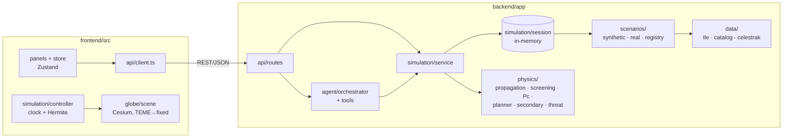

# System architecture

Aegis Orbit is a FastAPI backend that owns all physics and session state, plus a React + CesiumJS
frontend that only samples and draws precomputed trajectories. The REST routes and the LLM agent go
through the same service layer.

## Layers

| Package | Role | Wiki page |
|---|---|---|
| `backend/app/physics/` | Pure computation; no HTTP and no session | [screening](screening-pipeline.md), [planner](maneuver-planner.md), concepts |
| `backend/app/data/` | TLE parsing, the object model, the CelesTrak cache | [data layer](data-layer.md) |
| `backend/app/scenarios/` | Builds the two scenarios' catalogs and windows | [synthetic](../scenarios/synthetic-conjunction.md), [real ISS](../scenarios/real-iss.md) |
| `backend/app/simulation/` | Session state, plus a service layer that returns plain dicts | [simulation service](simulation-service.md) |
| `backend/app/agent/` | Tool registry, the deterministic agent workflow, report validation | [agent orchestrator](agent-orchestrator.md) |
| `backend/app/api/`, `schemas/` | Thin FastAPI routes and Pydantic response models | [simulation service](simulation-service.md#rest-api) |
| `frontend/src/` | Clock, interpolation, Cesium scene, store, panels | [frontend globe](frontend-globe.md) |

## Cross-cutting decisions

- **One service layer for HTTP and for the agent.** The service functions return dictionaries shaped
  like the response models, so the agent calls the physics engine without going through HTTP
  ([service.py:1-6](../../../backend/app/simulation/service.py#L1-L6)).
- **State lives in memory.** There is one `SimulationSession` per scenario for a single user, and a
  restart clears it ([session.py:1-3](../../../backend/app/simulation/session.py#L1-L3)). Scenarios are
  deterministic, so they rebuild identically.
- **Units and frames are fixed at the boundary.** Everything is TEME in km and km/s, Δv is in m/s and
  times are ISO 8601 UTC ([reference frames](../concepts/reference-frames.md)).
- **Errors map to HTTP status codes.** `NotFound` → 404, `BadRequest` → 400, `Conflict` → 409 and
  `DataUnavailable` → 503 ([routes.py:36-46](../../../backend/app/api/routes.py#L36-L46)).
- **Configuration** comes from `pydantic-settings`, reading `.env` in the repo root or `backend/`.
  Every threshold can be overridden by an environment variable of the same name
  ([config.py:17-22](../../../backend/app/config.py#L17-L22)).
- **The frontend never computes orbits.** The backend precomputes trajectories at 60–120 s, and the
  browser interpolates them ([frontend globe](frontend-globe.md)).

## Stack

The backend runs Python 3.12 with FastAPI, Pydantic 2, NumPy, SciPy, `sgp4` and `google-genai`. The
frontend uses React 19, TypeScript 5.9, Vite 7, CesiumJS 1.146, Tailwind 4, Recharts 3, Zustand 5 and
Vitest ([package.json](../../../frontend/package.json), [README](../../../README.md#stack)).

## See also

[Overview](../overview.md) · [Simulation service and API](simulation-service.md) ·
[Agent orchestrator](agent-orchestrator.md)
