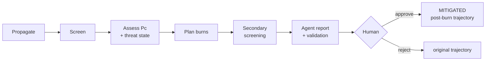

# Aegis Orbit: overview

Aegis Orbit is a research simulator that predicts close approaches between satellites and debris,
quantifies their risk honestly, plans and re-checks small avoidance burns, and has an LLM explain the
recommendation to a human who approves or rejects it. Nothing it does commands a real spacecraft.

## The pipeline

| Stage | Idea | Implementation |
|---|---|---|
| Propagate | [Propagation models](concepts/propagation-models.md), [reference frames](concepts/reference-frames.md) | `physics/propagation.py` |
| Screen | [Conjunction, TCA, miss distance](concepts/conjunction.md) | [Screening pipeline](components/screening-pipeline.md) |
| Assess | [Collision probability](concepts/collision-probability.md), [basis labels](concepts/covariance-and-basis-labels.md), [threat states](concepts/threat-states.md) | `physics/collision_probability.py`, `physics/threat.py` |
| Plan | [Avoidance maneuvers](concepts/avoidance-maneuvers.md) | [Maneuver planner](components/maneuver-planner.md) |
| Re-check | [Secondary screening](concepts/secondary-screening.md) | `physics/secondary_screening.py` |
| Explain | [Agent integrity](concepts/agent-integrity.md) | [Agent orchestrator](components/agent-orchestrator.md) |
| Decide and show | human in the loop | [Simulation service and API](components/simulation-service.md), [frontend globe](components/frontend-globe.md) |

How the parts fit together is in [architecture](components/architecture.md). The input data is covered
in [GP elements and TLEs](concepts/gp-elements-and-tle.md) and the [data layer](components/data-layer.md).

## Five commitments that recur everywhere

1. **The backend owns every number.** The LLM chooses tools and writes prose, and a validator checks
   its recommendation against session records ([agent integrity](concepts/agent-integrity.md)).
2. **Uncertainty is labelled, not hidden.** Without covariance, Pc is `UNVERIFIED`, never invented.
   Every radius, covariance and position carries a basis label, and illustrative numbers say so
   ([basis labels](concepts/covariance-and-basis-labels.md)).
3. **Models are never silently swapped.** SGP4 covers catalog objects and two-body + J2 covers
   synthetic and post-burn arcs. The gap between them is reported as "model consistency"
   ([propagation models](concepts/propagation-models.md)).
4. **Clearing the threat is not enough.** Every candidate is re-screened against the whole catalog, and
   MITIGATED requires a PASS ([secondary screening](concepts/secondary-screening.md)).
5. **The demo is deterministic.** The synthetic encounter rebuilds to millimetres, and the rule-based
   agent produces the same validated report for the same session state, fully offline
   ([synthetic scenario](scenarios/synthetic-conjunction.md)).

## What we know from running it

At commit `a34844b` ([baseline run](analyses/2026-10-17-baseline-pipeline-run.md)):

- **Synthetic.** The miss is 353.5 m at 7.66 km/s with Pc 5.7e-4 (illustrative), so the encounter is
  CRITICAL. The best fix is a 0.05 m/s **retrograde** burn 1.5 orbits ahead, giving 1.458 km and Pc
  9e-10. Secondary screening passes and approval gives MITIGATED. The agent run takes 7.5 s end to end.
- **Real ISS.** Over 24 h there are 12 passes between 6.7 and 24.8 km. All are UNVERIFIED for Pc, and
  the closest sets the session to UNVERIFIED. A docked Progress is correctly treated as co-orbital.
- **Why the planner picks what it picks.** Linear relative motion explains it to within 3 m:
  along-track burns accumulate, while radial and cross-track burns oscillate back to zero. That is
  why the default half-orbit grid can never choose a cross-track burn
  ([avoidance maneuvers](concepts/avoidance-maneuvers.md#why-direction-and-lead-time-matter)).

## Where the wiki is thin

- The frontend panels haven't been ingested.
- No raw domain sources have been ingested yet, so astrodynamics claims beyond the code are marked
  *(background)*.
- One probable bug and several design questions are open.

All three are tracked in [open questions](analyses/open-questions.md).
